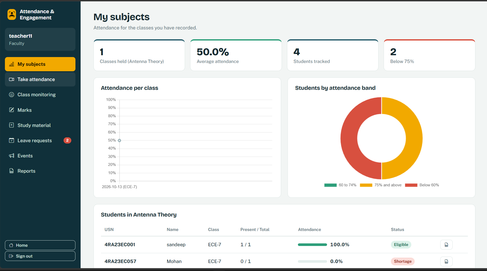
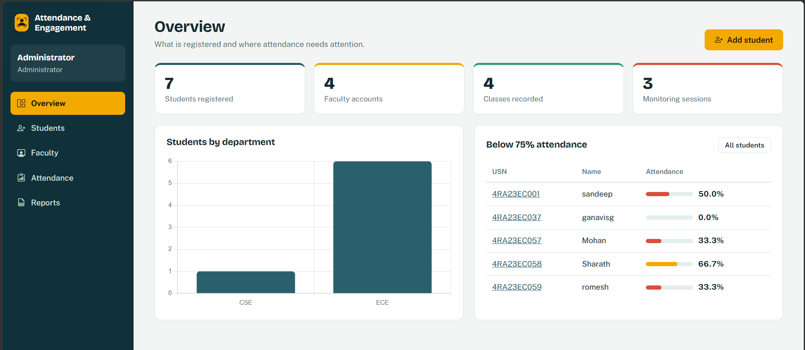
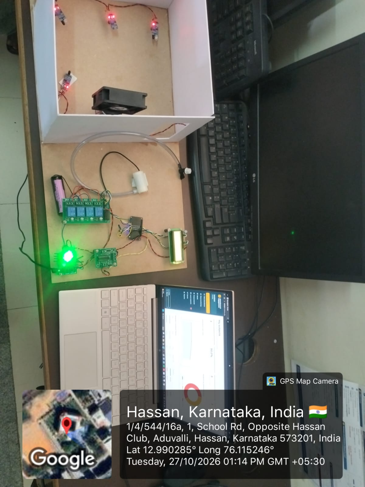
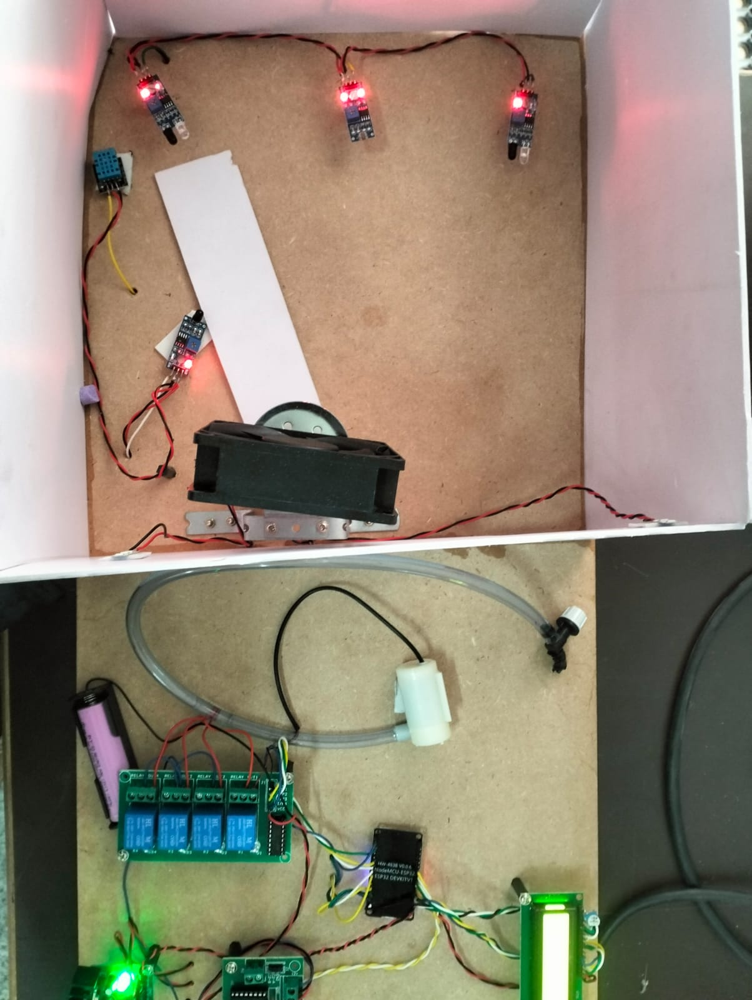

# Attendance system and student emotion based engagement prediction

## Screenshots

### Software

| Faculty dashboard | Admin overview |
|---|---|
|  |  |

### Hardware

| Full setup | Sensors and controller close-up |
|---|---|
|  |  |

## Dashboards
* **Admin:** overview, students, faculty, attendance and reports.
* **Faculty:** my subjects, take attendance, class monitoring, marks, study material, leave requests, events and reports.
* **Student:** personal dashboard with attendance, study material, leave requests, events, and their own Excel report.

## Folder layout
```
attendance_app/
├─ app.py              Flask app (routes)
├─ database.py         sqlite3 layer (attendance.db is created on first run)
├─ reports.py          Excel report builders (openpyxl)
├─ face_common.py      IdData / load_model / setup  (shared FaceNet code)
├─ dataset.py          face enrolment   (python dataset.py <USN>)
├─ recognition.py      attendance camera (python recognition.py --out r.json)
├─ monitor.py          recognition + emotion camera
├─ emotion_worker.py   DeepFace worker used by monitor.py
├─ detect_and_align.py <-- YOUR existing file, copy it here
├─ 20170512-110547/    <-- YOUR existing model folder (20170512-110547.pb), copy it here
├─ templates/  static/  tmp/
```
## Run
```
pip install -r requirements.txt
python app.py          # http://127.0.0.1:5000
```
Admin login: `admin` / `admin123`. Faculty accounts are created by the admin.

## Notes
* Camera windows open on the computer that runs Flask. Press `c` to capture a face sample, `q` to finish.
* Face folders are named by USN, so `recognition.py` returns USNs directly.
* Slideshow: drop your own images into `static/slides/` and they replace the default stock photos.
* Change departments in `database.py` (`DEFAULT_DEPARTMENTS`), the admin password in `app.py`, and set `SECRET_KEY` in production.
* Engagement score: happy 100, surprise 90, neutral 70, fear 35, angry 30, disgust 20, sad 20 (edit `EMOTION_WEIGHTS` in `app.py`).
* If DeepFace complains about Keras on newer TensorFlow, `pip install tf-keras`.

## Roles and logins
| Role | Username | Password |
|---|---|---|
| Admin | `admin` | `admin123` |
| Faculty | created by admin (subjects are picked from the built-in catalog) | set by admin |
| Student | the student's **name** (not case sensitive) | the student's **USN** |

## Marks, events, leave, reports
* Marks per subject: internal /50, activity /20, lab /30 (change in `database.py`: `INTERNAL_MAX, ACTIVITY_MAX, LAB_MAX`). Lab is only enabled for subjects flagged `has_lab` in the catalog.
* Subject catalog: `SUBJECT_CATALOG` in `database.py` (69 real-world subjects across the 7 departments). Add or edit entries there; new ones are inserted on the next start.
* Events: images are saved to `static/uploads/events/`.
* Leave requests go to faculty of the student's department, and to faculty who have taught that student's class. Approved leave is flagged on the attendance review screen.
* Excel: admin (Reports page, Attendance page, student page), faculty (Reports page, student rows, monitoring results) and students (their own report).

---

## Hardware: ESP32 Classroom Occupancy Model

A small classroom model that senses occupancy and room conditions, controls appliances through relays, and sends alerts on Telegram. Code: `hardware/esp32_classroom_occupancy/esp32_classroom_occupancy.ino`

### Components
* ESP32 DevKit (main controller with WiFi)
* IR sensor modules, left and right (detect people)
* LDR light sensor module (darkness detection)
* Flame sensor module (fire detection)
* DHT11 (temperature and humidity)
* 4-channel relay module
* 16x2 LCD
* DC motor with motor driver
* Fan and mini water pump
* Battery and power supply

### Behaviour
* Fire detected: LCD shows `FIRE DETECTED`, Relay 1 turns on, Telegram alert is sent.
* Temperature above 30 C with someone present: Relay 2 turns on for cooling.
* Dark room with left or right IR triggered: Relay 3 or Relay 4 turns on the matching light.
* Left and right IR sensors move the motor forward or backward automatically.
* Serial commands `F`, `B`, `S` (9600 baud) give manual forward, backward and stop.

### Pin mapping
| Function | ESP32 pin |
|---|---|
| LCD RS, EN, D4, D5, D6, D7 | 13, 12, 14, 27, 26, 25 |
| Left IR, Right IR | 15, 2 |
| LDR, Flame sensor | 4, 18 |
| DHT11 | 5 |
| Relays 1 to 4 | 19, 21, 22, 23 |
| Motor driver IN1, IN2 | 33, 32 |

### Upload the code
1. Install the Arduino IDE and ESP32 board support.
2. Install the libraries: DHT sensor library, UniversalTelegramBot, ArduinoJson.
3. Open the `.ino` file and replace the placeholders `YOUR_WIFI_NAME`, `YOUR_WIFI_PASSWORD`, `YOUR_TELEGRAM_BOT_TOKEN` and `YOUR_TELEGRAM_CHAT_ID` with your own values.
4. Select **ESP32 Dev Module** and the correct COM port, then upload.

Never commit your real WiFi password or Telegram bot token to GitHub.
